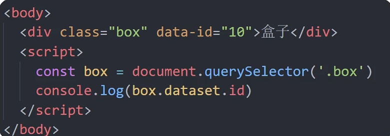

## 声明变量const优先

## DOM树和DOM对象
1. 作用：使用js去操作html和浏览器
2. 分类：DOM（文档对象类型）、BOM（浏览器对象类型）
 - DOM是什么？作用？
 - - DOM是文档对象模型
 - - 操作网页内容，可以开发网页内容特效和实现用户交互
3. DOM树
- - 树状结构，用来体现标签与标签之间的关系
4. DOM对象 
 - DOM的核心思想：把网页内容当做对象来处理
 - document对象：
  - - 是DOM里提供的一个对象
  - - 浏览器根据html标签生成的JS对象
   - - 他提供的属性和方法都是用来访问和操作网页内容的
   - - 网页所有内容都在document（DOM里提供的一个对象）里面 

## 获取DOM对象
### 通过css选择器来获取DOM元素
1. 选择匹配的*第一个*元素
 - 语法:
  - - const box = document.querySelector('css选择器') 返回值：返回的是匹配的第一个元素，一个html元素对象
  - - - const box = document.querySelector('#类名')
  - - - const li = document.querySElector('ul li:first-child)
  - - const lis = document.querySelsectorAll('css选择器') 返回值：返回的是匹配的第一个元素，一个html元素对象

 
2. 其他获取方法

3. 操作元素内容
- 对象.innerText属性：获取文字内容
- - 将文本内容添加/更新到任意标签位置
- - 显示纯文本，不解析标签
 
- 对象.innerHTML属性：
- - 将文本内容添加/更新到任意标签位置
- - 识别解析标签

4. 操作元素属性
 - 元素*常用属性*
 - - 通过js设置/修改标签元素实行，比如通过src更换图片
 - - 常见属性比如：href、title、src等
 - - 语法：对象.属性 = 值

 - 元素*样式属性*
 - - 语法：对象.style.样式属性 = 值
 - - - 生成的是行内样式，权重较高
  - - - 修改样式比较少的情况下比较有优势

 - - 通过className修改样式属性

 - - **通过classList操控类控制css**：
  - - - 追加一个类：元素.classList.add('类名)
  - - - 删除一个类：元素.classList.remove('类名)
  - - - 切换一个类：元素.classList.toggle('类名)
  - - - 不影响以前的类名

- 操作*表单元素*属性
- - 表单.value = '用户名'
- - 表单.type = 'password'
- - 表单属性中添加就有效果，移除就无，一律使用布尔值表示，如果为true 代表添加了该属性，如果是false代表移除了该属性，比如：
 - - - disabled、checked、selected

- 操作自定义属性
 - - html5中推出来了专门的data-自定义属性
 - - 在标签上一律以data- 开头
 - - 在DOM对象上一律以dataset对象方式获取
 

- 定时器 - 间歇函数
- - 目标：能够使用定时器函数重复执行代码
- - 定时器函数可以开启和关闭定时器
1. 开启定时器
 - setInterval(函数，间隔时间)
 - - 作用:每隔一段时间调用这个函数
 - - 间隔时间单位是毫秒ms

